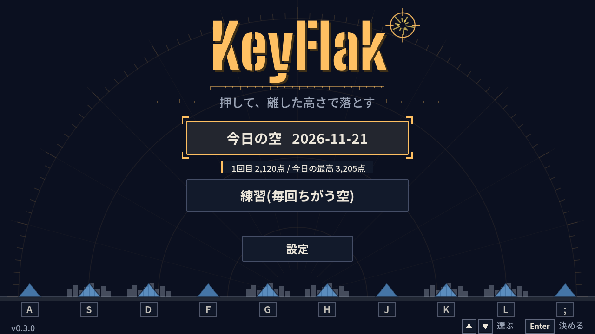
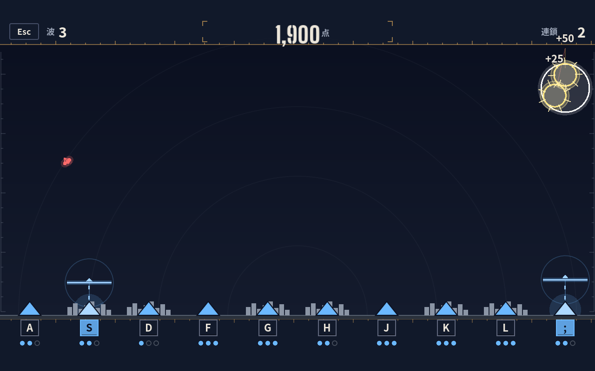
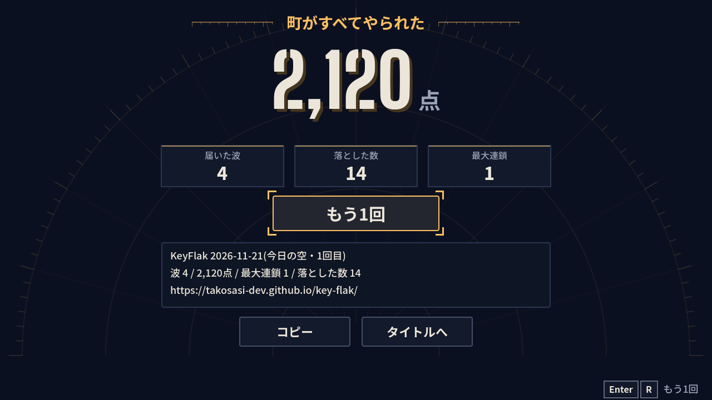

# KeyFlak

空から落ちてくるミサイルから 6 つの町を守るゲームです。キーボードの中の段の 10 キー(**A S D F G H J K L ;**)が地上の 10 基の発射台で、**押している間に照準が昇り、離した高さで迎撃の爆発が起きます**。爆発に巻き込まれたミサイルは誘爆し、連鎖するほど点が跳ねます。ブラウザで開くだけで遊べます。

**▶ 遊ぶ: https://takosasi-dev.github.io/key-flak/** (デスクトップの Chrome・Edge・Firefox。キーボードで遊びます。インストール不要)

> v0.3.0。人に遊んでもらう確かめはまだです。照準の昇る速さ・爆発の大きさ・ミサイルの速さは仕様の初期値のままで、人が遊んで決めた値ではありません。

| タイトル | 押さえて昇る照準・離した高さで落とす | 結果 |
|---|---|---|
|  |  |  |

見た目は「夜の対空監視所」: レーダーのスコープの硝子に、燐光の琥珀の目盛りと照準の角。題字と数字は型紙の字(Big Shoulders Stencil)です。「点滅を弱める」を入れると、画面の切り替わりやレーダーの動きも止まります。

## 遊び方

- キーを押すと、その真上で照準の線が昇ります。照準のまわりの薄い輪が、離した時の爆発の大きさです。ミサイルの線と重なる高さで離すと、そこで爆発します。押しっぱなしにすると頂上で自動で爆発します。最初の 1 本だけ、押すキーを画面で案内します。
- 発射台は 1 波に 3 発まで(下の丸が残りの数)。弾が無い時と、止まっている時は撃てません。
- ミサイルが地面に着くと、その列の町を失い、その列の発射台はその波の間止まります。町が全部やられたら終わりです。
- 波は 1 つずつ新しい種類を出します: 真っすぐ → 斜め(波 2)→ 分かれる(波 3)→ 速い(波 4)→ 爆撃機(波 5)。地面に着く 1 秒前のミサイルは、落ちる先に赤い印が出ます。
- 何本でも同時に押さえて、別々に離せます。
- Esc で一時停止。設定に「キーの確かめ」があり、同時に押さえたキーが届いているかを見られます。

点 = 1 回の爆発から続いた連鎖の **n 本目に 25 × n**(爆撃機は 100 × n)。4 本の連鎖なら 25 + 50 + 75 + 100 = 250 点。波を越えると、残った町 × 100 と残った弾 × 5 のボーナス。

## 今日の空

「今日の空」は日付で決まり、同じ日なら誰でも同じ攻撃の並びです。結果画面の文字をコピーして貼れば比べられます。

```
KeyFlak 2026-11-19(今日の空・1回目)
波 7 / 18,450点 / 最大連鎖 6 / 落とした数 84
https://takosasi-dev.github.io/key-flak/
```

「練習」は毎回ちがう空です。

## しくみ

- **ゲームの決まりは `core/` にだけ**あります(照準・爆発・ミサイル・着弾・点・波)。画面は `sim.snapshot()` と `sim.events()` を読んで描くだけです。
- 1/120 秒刻みで進め、入力は発射台の番号(0〜9)の「押す」と「離す」だけを受けます。キーは位置(`physical_keycode`)で取るので、JIS 配列でも US 配列でも同じ位置が同じ発射台です。
- 攻撃の並びは種だけで決まり、操作では変わりません。同じ種と同じ入力の記録なら、Windows と Linux(CI)で同じ結果になることをテストで確かめています。
- 保存はブラウザの中(localStorage の `key-flak/save`)だけです。サーバーとの通信やアクセス解析はありません。

## 動作環境

- Godot 4.7.2-stable(GDScript、レンダラー Compatibility)
- Web 書き出しはスレッド無し・拡張無し

## 開発

```
# テスト(全件成功で終了コード 0)
godot --headless --import
godot --headless --script res://tests/run_tests.gd

# Web 書き出し(書き出しテンプレート 4.7.2 が要る)
godot --headless --export-release "Web" build/web/index.html

# 同じことを Python から(GODOT に Godot の場所を入れる)。smoke は本体を窓なしで S0 → 結果まで 2 回通す
python tools/gd.py test
python tools/gd.py export
python tools/gd.py smoke 300000 --auto
python tools/gd.py run res://tools/perf.gd   # ミサイル 60・爆発 40 の負荷を測る(CPU 側だけ)
python tools/gd.py run res://tools/make_theme.gd   # 見た目の型 ui/theme.tres を作り直す(色を変えた時)

# ブラウザでの確かめ(Node.js 22 以上と Chrome。窓を出さない・音を消す・使い捨てのプロフィール)
node tests/web/check.mjs      # S0 → 結果 → もう1回・同時押さえ・一時停止・保存・コピー・3 分間の通信 0 件
node tests/web/shots.mjs      # 遊びの場面を build/web_shots/ に撮る(--docs で README の 3 枚を docs/ に)
node tests/web/look.mjs after # 全部の画面を 5 つの窓の大きさで撮る
node tests/web/boot.mjs 3     # 起動の秒数と、キーから遊びの画面までの時間

# 字体を画面の文字に絞る・効果音を作る(Python)
pip install fonttools
python tools/subset_font.py
python tools/gen_sfx.py
```

`main` に push すると、GitHub Actions がテスト → Web 書き出し → GitHub Pages への配置を行います(`.github/workflows/pages.yml`)。

## 開発状況

- v0.3.0(UI の作り直し)。テストはヘッドレスの Godot で通っています(82 件)。
- 窓を出さない Chrome(使い捨てのプロフィール・消音)で、起動とひと通りの流れを確かめました: S0 → タイトル → 今日の空 → 一時停止 → 結果 → もう1回、本物のキーのイベントで押さえて離すと爆発する・3 キーと 10 キーの同時押さえ・タブが裏で一時停止・保存(ParryDuel の保存を消さない)・コピー・読み込みの後 3 分間の通信 0 件・コンソールのエラー 0 件。
- まだ確かめていないこと: 人が遊ぶこと、本物のキーボードでの同時押さえ、Edge・Firefox、音を耳で聞くこと。
- ミサイル 60・爆発 40・爆撃機 3・照準 10 の負荷で、1 フレームの CPU 時間の 95% 値は約 10 ms(ヘッドレスの測定。画面に描く GPU の時間は入っていない)。
- 撤退基準のうち、R-1(続けて遊びたくなるか)・R-2(押す長さで狙えるか)・R-3(隣り合うキーの同時押さえが届くか)は、人と本物のキーボードが要るので未判定です。

## ライセンス

MIT(`LICENSE`)。同梱の字体 2 つ(Noto Sans JP・Big Shoulders Stencil)は SIL Open Font License 1.1 です(`THIRD-PARTY-NOTICES.md`、原文は `assets/fonts/OFL_*.txt`)。
